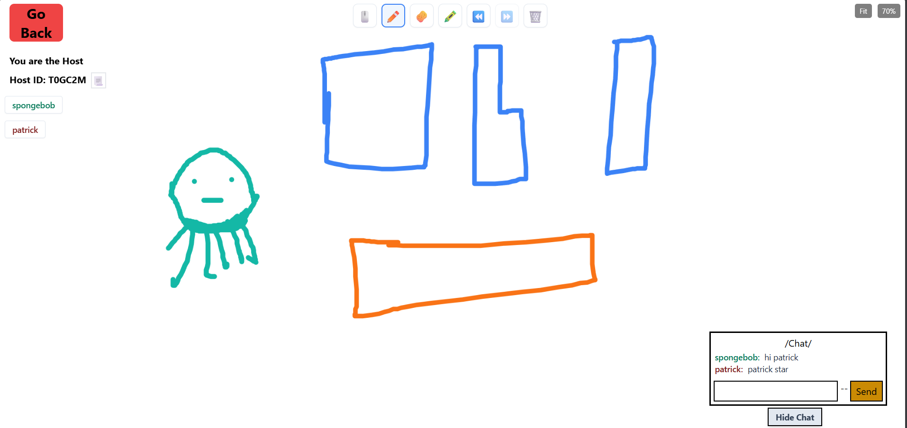

# Whiteboard — Cloud-Native GitOps & Infrastructure Platform

A real-time collaborative drawing platform deployed on AWS EKS using an automated GitOps delivery pipeline and codified infrastructure.

> **About the Application**: The workload is a 3-tier web application comprising a React (Vite/Tailwind) single-page frontend served by unprivileged Nginx, a Node.js/Express WebSocket backend supporting real-time canvas synchronization, and an in-cluster MongoDB database. **The primary purpose of this project is demonstrating modern DevOps, cloud infrastructure, and GitOps lifecycle management.**



---

## Table of Contents

- [Cloud Infrastructure Architecture](#cloud-infrastructure-architecture)
- [Repository Structure](#repository-structure)
- [Cloud Infrastructure — Terraform (`wb-infra`)](#cloud-infrastructure--terraform-wb-infra)
  - [Two-Phase Provisioning](#two-phase-provisioning)
  - [Networking & VPC](#networking--vpc)
  - [EKS Cluster Configuration](#eks-cluster-configuration)
  - [IAM & EKS Pod Identity](#iam--eks-pod-identity)
  - [Secrets Management & Remote State](#secrets-management--remote-state)
  - [ArgoCD Bootstrap & Teardown Guard](#argocd-bootstrap--teardown-guard)
- [Kubernetes Platform — GitOps (`wb-gitops`)](#kubernetes-platform--gitops-wb-gitops)
  - [App-of-Apps Pattern](#app-of-apps-pattern)
  - [Workloads & Pod Security](#workloads--pod-security)
  - [Platform Addons & Observability](#platform-addons--observability)
  - [External Secrets Sync](#external-secrets-sync)
  - [Ingress, Autoscaling & Resilience](#ingress-autoscaling--resilience)
- [CI/CD Pipeline (`wb-code`)](#cicd-pipeline-wb-code)
  - [CI/CD Workflow Diagram](#cicd-workflow-diagram)
  - [Pipeline Breakdown](#pipeline-breakdown)
  - [OIDC Authentication (Zero AWS Secrets)](#oidc-authentication-zero-aws-secrets)
  - [Security Gates & Quality Assurance](#security-gates--quality-assurance)
- [Local Development & Automation](#local-development--automation)
- [Tech Stack Summary](#tech-stack-summary)

---

## Cloud Infrastructure Architecture

The AWS environment provisions a multi-AZ Virtual Private Cloud hosting an Amazon EKS cluster with private worker nodes, internet-facing load balancing, and secure outbound egress.


---

## Repository Structure

The infrastructure and application lifecycle is split across three dedicated GitOps repositories:

| Repository | Purpose | Primary Technologies |
|---|---|---|
| **[`wb-code`](.)** | Application source code, Dockerfiles, GitHub Actions CI workflows, Taskfile | Node.js, React, Docker, GitHub Actions |
| **[`wb-gitops`](https://github.com/abSketcher/wb-gitops)** | Kubernetes manifests, Kustomize overlays, ArgoCD platform charts | K8s, Kustomize, ArgoCD, Helm |
| **[`wb-infra`](https://github.com/abSketcher/wb-infra)** | Cloud infrastructure as code, IAM roles, cluster provisioning | Terraform, AWS, Helm |

---

## Cloud Infrastructure — Terraform (`wb-infra`)

All AWS resources are codified with Terraform (>= 1.10, AWS Provider ~6.0) using official community modules. The environment is 100% reproducible: `terraform apply` provisions the complete stack from VPC to running ArgoCD apps, while `terraform destroy` cleanly tears it down without leaving orphaned cloud resources.

### Two-Phase Provisioning

Provisioning is split into two sequential root modules:

```
Phase 1: infra/bootstrap/ (Local State)
  ├── S3 State Bucket (versioning, AES256 encryption, public access block)
  └── GitHub Actions OIDC IAM Role (scoped ECR push permissions)
         │
         ▼ (Bucket ID passed to backend.hcl)
Phase 2: infra/cluster/ (Remote S3 State)
  ├── VPC + Subnets + NAT Gateway
  ├── EKS Cluster + Managed Node Group + Addons
  ├── IAM Roles + EKS Pod Identity Associations
  ├── AWS Secrets Manager (generated MongoDB credentials)
  ├── ArgoCD Helm Release + Git Deploy Key
  └── Root App-of-Apps Application
```

### Networking & VPC

- **Module**: `terraform-aws-modules/vpc/aws` (~6.0)
- **Subnets**: 2 Public (`/24`, ELB discoverable) and 2 Private (`/20`, internal ELB tagged) spread across 2 availability zones.
- **NAT Gateway**: Single NAT Gateway in Public Subnet A for private subnet outbound internet egress (cost-optimized).

### EKS Cluster Configuration

- **Module**: `terraform-aws-modules/eks/aws` (~21.0), Kubernetes v1.32.
- **Node Group**: Managed node group running in private subnets with fixed 2x worker nodes.
- **API Access**: Public and private endpoints enabled; cluster creator admin permissions enabled.
- **Cluster Addons**: `coredns`, `kube-proxy`, `eks-pod-identity-agent` (pre-compute), `vpc-cni` (network policies enabled), `aws-ebs-csi-driver` (with pod identity), and `metrics-server`.

### IAM & EKS Pod Identity

Cluster workloads use **EKS Pod Identity** (`pods.eks.amazonaws.com`) rather than traditional IRSA:

| Role Name | Kubernetes Service Account | Namespace | Policy & Scope |
|---|---|---|---|
| `myapp-eso` | `external-secrets` | `external-secrets` | Read access to target AWS Secrets Manager ARN |
| `myapp-lbc` | `aws-load-balancer-controller` | `kube-system` | AWS Load Balancer Controller policy (ELB, Target Groups, EC2) |
| `{cluster}-ebs-csi` | `ebs-csi-controller-sa` | `kube-system` | Managed `AmazonEBSCSIDriverPolicy` |
| `github-actions-ecr` | N/A (GitHub OIDC) | CI Runner | ECR authorization + push permissions scoped to `whiteboard/*` |

### Secrets Management & Remote State

- **Secrets Generation**: Terraform generates random 48-character passwords and stores the initial root/app credentials in AWS Secrets Manager (`recovery_window_in_days = 0` for immediate reprovisioning).
- **Backend State**: S3 bucket backend using native S3 lockfiles (`use_lockfile = true`) and client-side encryption.

### ArgoCD Bootstrap & Teardown Guard

1. **Bootstrap**: Terraform deploys ArgoCD into namespace `argocd` using a vendored Helm chart, registers the GitOps SSH deploy key, and applies the root App-of-Apps chart.
2. **Teardown Guard**: A `terraform_data` lifecycle provisioner runs pre-destroy cleanup scripts to disable auto-sync, delete Ingress resources, wait for AWS ALBs to deregister (with CLI fallback), and remove PVCs before Terraform drops the VPC and subnets.

---

## Kubernetes Platform — GitOps (`wb-gitops`)

Cluster resources are declaratively managed by [ArgoCD](https://argo-cd.readthedocs.io/) using GitOps reconciliation with automated prune, sync, and self-healing.

### App-of-Apps Pattern

The `platform/` Helm chart configures the root ArgoCD application, which stamps out 6 sub-applications orchestrated via sync waves:

```
Sync Wave 0: Foundational Platform
  ├── aws-load-balancer-controller (Helm v3.6.1, kube-system)
  ├── external-secrets (Helm v2.13.0, CRDs installed, external-secrets)
  └── loki (Helm v7.5.0, SingleBinary, 7-day retention, logging)

Sync Wave 1: Workloads & Monitoring
  ├── myapp (Kustomize overlays/aws, namespace: myapp)
  ├── alloy (Helm v1.15.0, DaemonSet log collector, logging)
  └── prometheus-stack (Helm v92.13.0, Prometheus + Grafana, monitoring)
```

### Workloads & Pod Security

The application namespace `myapp` enforces **Pod Security Standards: `restricted`**:
- **Nginx Frontend (`web`)**: 2 replicas, read-only root filesystem, unprivileged user (UID 101), all capabilities dropped, topology spread constraints across hosts.
- **Node.js API (`backend`)**: 2-4 replicas, read-only root filesystem, unprivileged user (UID 1000), seccomp `RuntimeDefault`, `/tmp` emptyDir mount.
- **MongoDB Database (`db`)**: Single-replica StatefulSet with 2Gi encrypted `gp3` volume (via AWS EBS CSI driver), non-root execution (UID 999), and auto-initializing user role scripts.

### Platform Addons & Observability

- **Ingress Controller**: AWS Load Balancer Controller automatically provisions and reconfigures AWS Application Load Balancers from Kubernetes `Ingress` specs.
- **Log Aggregation**: Grafana Loki (SingleBinary mode with 10Gi filesystem persistence) fed by Grafana Alloy running as a cluster DaemonSet scraping container runtimes.
- **Metrics & Dashboards**: `kube-prometheus-stack` collects node and container metrics with Grafana pre-provisioned with Loki datasource connectivity.

### External Secrets Sync

```
AWS Secrets Manager (myapp/db-credentials)
               │
               ▼ (Refreshed hourly via EKS Pod Identity)
ClusterSecretStore / ExternalSecret
               │
               ▼
Kubernetes Secret: db-credentials (namespace: myapp)
  ├── MONGO_INITDB_ROOT_USERNAME / PASSWORD
  └── MONGO_APP_USERNAME / PASSWORD
```

### Ingress, Autoscaling & Resilience

- **Ingress**: AWS ALB Ingress (Internet-facing, IP target-mode) routing `/` to the frontend service and `/healthz` for health checks.
- **Horizontal Pod Autoscaling**: Backend scales dynamically from 2 to 4 pods based on 70% average CPU utilization.
- **High Availability**: Pod Disruption Budgets (`minAvailable: 1`) on both web and backend prevent downtime during node rollouts and cluster maintenance.

---

## CI/CD Pipeline (`wb-code`)

The code repository includes 6 purpose-built GitHub Actions workflows ensuring fast builds, zero-secret deployments, and strict supply chain security.

### CI/CD Workflow Diagram

The complete automated delivery pipeline—from developer push to rolling production rollout—is shown below:


### Pipeline Breakdown

`ci.yaml` runs on every push to `main`:

1. **Path Filtering (`dorny/paths-filter`)**: Detects changes in `./App` vs `./server` to execute builds only for modified services.
2. **Keyless AWS Authentication**: Uses GitHub OIDC federation to request temporary STS credentials for role `github-actions-ecr` (no static keys).
3. **Parallel Docker Builds (Matrix)**: Builds frontend and backend container images in parallel, tagging each with the short commit SHA.
4. **Vulnerability Scanning (Trivy)**: Scans built images for CRITICAL CVEs and exposed credentials before publishing.
5. **Publish & GitOps Handoff**: Pushes container images to AWS ECR, checks out `wb-gitops`, updates image tags in `overlays/aws/kustomization.yaml`, and commits with a concurrency retry loop.
6. **ArgoCD Reconciliation**: ArgoCD detects the new commit in `wb-gitops` and initiates an automated, zero-downtime rolling update in EKS.

### OIDC Authentication (Zero AWS Secrets)

Authentication to AWS is entirely keyless using OpenID Connect (OIDC):
- Workflow sets `permissions: id-token: write`.
- `aws-actions/configure-aws-credentials` assumes `arn:aws:iam::<ACCOUNT_ID>:role/github-actions-ecr`.
- The AWS IAM role trust policy restricts access strictly to the `main` branch of this repository.
- **No static AWS access keys or secrets are stored in GitHub repository settings.**

### Security Gates & Quality Assurance

- **Trivy Image Scan (`ci.yaml`)**: Scans built containers for OS/library vulnerabilities and credentials prior to pushing.
- **CodeQL (`Codeql.yaml`)**: Automated static code analysis running JavaScript/TypeScript security-extended query packs.
- **Dockerfile Linting (`dockerfile_scan.yaml`)**: Scans Dockerfiles for misconfigurations, root user usage, and best practice adherence.
- **Automated Tests (`test.yaml`)**: Runs Vitest (frontend) and Node.js native test runners across pull requests.
- **Dependabot Auto-Merge (`dependabot-auto-merge.yaml`)**: Automatically validates and squash-merges routine dependency updates.

---

## Local Development & Automation

A local development stack mirrors the containerized setup:

```bash
# Start full local stack (Nginx + Express + MongoDB)
task compose
# Or directly with Docker:
docker compose up -d --build

# Stop the local stack
task compose-down

# Run unit tests
task test-react    # Vitest for frontend
task test-node     # Node native test runner for backend

# Test GitHub Actions CI workflow locally using nektos/act
task test:act-push
```

---

## Tech Stack Summary

| Domain | Selected Technologies |
|---|---|
| **Workload Architecture** | 3-Tier Web App (React 19 SPA, Node.js 20/Express API, MongoDB 8 StatefulSet) |
| **Container Engine** | Docker (unprivileged multi-stage builds, non-root users, digest pinning) |
| **Cloud Provider** | AWS (`ap-south-1`): VPC, EKS, ECR, ALB, Secrets Manager, EBS gp3 |
| **Infrastructure as Code** | Terraform (>= 1.10), AWS Provider (~6.0), S3 Native Locking |
| **Kubernetes Orchestration** | EKS (1.32), Kustomize, Pod Security Standards (`restricted`), HPA, PDB |
| **GitOps Engine** | ArgoCD (App-of-Apps pattern, 2-wave deployment, automated self-healing) |
| **Cluster Ingress & Networking**| AWS Load Balancer Controller (ALB), VPC-CNI Network Policies |
| **Identity & Access** | EKS Pod Identity (in-cluster), GitHub OIDC Federation (CI runner) |
| **Secrets Engine** | AWS Secrets Manager synchronized via External Secrets Operator (ESO) |
| **Observability & Logging** | Prometheus Stack (Prometheus + Grafana), Grafana Loki + Grafana Alloy |
| **CI/CD & Security** | GitHub Actions, Trivy Image Scanner, CodeQL, Dependabot |
